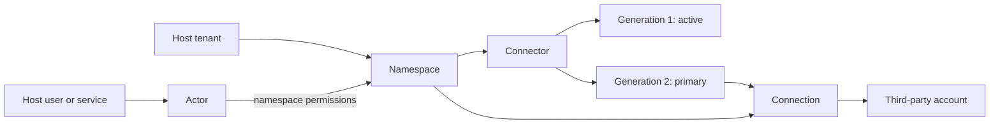
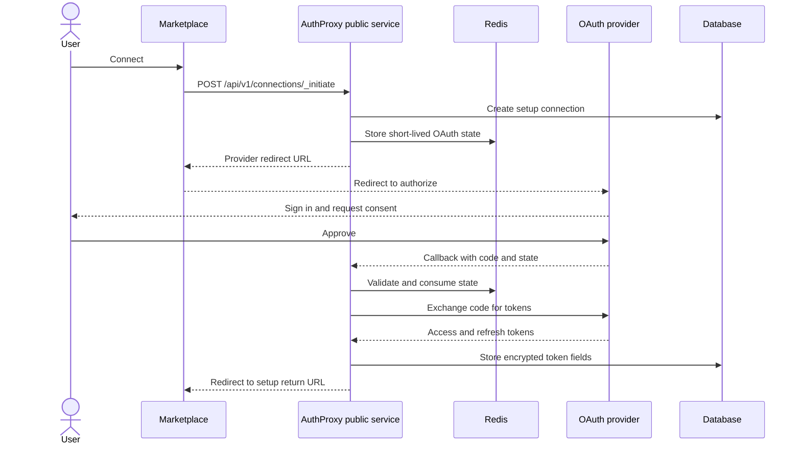

[How AuthProxy works](/concepts/) introduces AuthProxy's main ideas. This page
gives the exact rules behind them: how namespaces nest, how permissions match,
how connector generations are released, and how resources are named. It
covers four resources:

- **Namespaces**: where every other resource lives, and what permissions are
  granted on.
- **Actors**: the users and services that call AuthProxy.
- **Connectors**: definitions of how to connect to a provider.
- **Connections**: one connected account and its credentials.


## Namespaces

Namespaces are the grouping entity for all resources. Every resource belongs to a
namespace and permissions are defined against namespaces.

A **namespace** is a dot-separated path rooted at `root`:

```text
root
root.tenants
root.tenants.tnt_42
root.tenants.tnt_42.users.usr_7
```

Use namespaces for boundaries that must affect authorization or encryption.
AuthProxy has no separate concept of a resource owner, so namespaces are how
you express ownership. For example, `usr_7`'s private connections could be
created in `root.tenants.tnt_42.users.usr_7`, and `usr_7`'s actor given
permission on that namespace.

A permission can cover a namespace and everything below it with `**`. A
permission on `root.tenants.tnt_42.**` applies to `root.tenants.tnt_42` and
every descendant.

Each namespace can also be assigned its own encryption key, which its
descendants inherit. This lets you isolate one tenant's stored credentials
cryptographically from another's. See [Encryption](/security/encryption/).

Connectors are namespace-scoped. A connection may be created in the connector's
namespace or one of its children. This makes a connector defined at
`root.tenants` reusable for connections isolated under individual tenant
namespaces. The actor needs read access to the connector's namespace and create
or update access to the target connection namespace; those permission matchers
may be different.

Namespace segments support letters, numbers, `_`, and `-`, but a segment cannot
begin with `-`. If a host id contains `/`, `@`, or other unsupported characters,
map it to a stable namespace-safe key rather than using a mutable display name.
The final segment is also returned as the namespace's `name`.

## Actors and permissions

An **actor** is anything that calls AuthProxy: an end user, a backend service,
an operator, or an automated job. It is identified by the pair:

```text
(actor namespace, externalId)
```

`externalId` is the ID your application uses for that user or service. It
should never change or be reused. The same external ID can exist in different
namespaces as different actors. Actors can be created ahead of time through
the API, or created on first use from an actor definition carried in the JWT.
See [Authenticate requests to AuthProxy](/integration/authentication/).

Each permission combines a namespace matcher, resource types, verbs, and
optionally specific resource IDs. For example:

```json
{
  "namespace": "root.tenants.tnt_42.**",
  "resources": ["connections"],
  "verbs": ["create", "list", "get", "proxy"]
}
```

This permission lets the actor create, list, read, and proxy through
connections in `root.tenants.tnt_42` or any namespace below it.

A JWT can also carry its own, narrower permissions. AuthProxy allows a request
only if both the actor's permissions and the token's permissions allow it, so
a token can never grant more than the actor has. This is useful when handing a
token to a background job or an AI agent that should only do one thing.

A permission's namespace can refer to the actor's own data, as in
`root.tenants.{{labels.tenant_key}}.**`. The available values are
`external_id`, `labels.<key>`, and `annotations.<key>`. This lets many actors
share one permission template instead of each carrying its own copy. If a
referenced value is missing, or does not form a valid namespace segment, the
permission does not match.

## Connectors and generations

A **connector** is the reusable definition for a third-party system: its
authentication type and endpoints, OAuth scopes, setup forms and redirects,
health probes, and rate-limit handling. [Define a
connector](/integration/connectors/) explains how to write one.

A connector's ID, name, namespace, labels, and annotations are shared by all
of its versions. Its definition is versioned: each published change creates a
new **generation**, a complete, immutable snapshot identified by
`metadata.generation`. Each generation is in one of four release states:

| State | Meaning |
|---|---|
| `draft` | Editable work that is not offered for new connections. |
| `primary` | The published generation selected for new connections. |
| `active` | A previously primary generation still used by existing connections. |
| `archived` | A retired generation that is no longer available for new connections. |

Publishing a new primary generation moves the previous primary to `active`.
Existing connections remain bound to their recorded generation until they are
migrated; publishing does not silently reinterpret stored credentials.

For connector-authored setup behavior, see [Connector setup
flow](/integration/connector-setup-flow/) and [Connector
predicates](/integration/connector-predicates/). Administrative retirement
behavior is covered by [Connector lifecycle
operations](/operations/connector-lifecycle/).

## Connections

A **connection** is one configured instance of a connector. It records:

- a typed connector reference containing the logical ID and exact generation
- its immutable ID and mutable name
- its namespace
- encrypted OAuth tokens, API keys, and setup configuration
- setup and lifecycle state
- an independent `healthy` or `unhealthy` signal
- labels and annotations

Lifecycle and health answer different questions. Lifecycle says where the
connection is in setup and teardown. Health says whether its credentials work
right now. A connection can be `configured` but `unhealthy`, for example after
the provider revokes its refresh token. The user can then reconnect it from
the Marketplace, and it keeps the same ID.

Connection lifecycle states are `setup`, `configured`, `disabled`,
`disconnecting`, and `disconnected`.

When a caller uses `POST /api/v1/connections/{id}/_proxy`, AuthProxy checks
`connections:proxy` permission against the connection's namespace before it
loads credentials. The raw streaming route, `/_proxyRaw`, uses the same
permission.

## OAuth connection flow

For an OAuth connector, AuthProxy owns the authorization round trip and token
exchange. The host application and Marketplace never receive the provider
tokens.



The stored state binds the browser round trip to the actor, connector,
connection, and return destination. Connector setup may continue with
post-authorization forms or provider-backed resource selection before the
connection becomes `configured`.

## Modeling connection ownership

Connections do not have an actor-owner foreign key. Choose a namespace model
that expresses the ownership your product needs:

| Host behavior | Suggested connection namespace |
|---|---|
| Everyone in a tenant shares one installation | `root.tenants.tnt_42` |
| Each user has private credentials | `root.tenants.tnt_42.users.usr_7` |
| A team shares credentials inside a tenant | `root.tenants.tnt_42.teams.team_a` |

Permissions enforce the boundary. Labels such as
`app.example.com/installation-id=ins_123` make the connection easy to find, but
a label alone is not an authorization boundary.

## IDs and names

Every durable resource has two identifiers with different purposes:

- The **ID** is generated by AuthProxy, never changes, and remains in resource
  URLs and foreign-key references. Store it when another system needs a durable
  reference.
- The **name** is the human-readable identifier shown in lists and search. A
  create request may supply it; otherwise it defaults to the generated ID.
  Rename a resource with its ID-addressed `PATCH` endpoint. Renaming never
  changes its URL or references.

Names exist so that you can choose an identifier before a resource is
created. This lets YAML files applied with `ap apply` refer to resources
without knowing their generated IDs.

For actors, connectors, connections, keys, and rate limits, a live name is
unique for that resource type within one namespace. The same name can exist in
another namespace or on another resource type. Names are case-sensitive, and
deleting a resource releases its name for reuse. A conflicting create or rename
returns HTTP `409` without changing either resource.

Non-namespace names are 1–63 characters. They start and end with a letter or
number and may contain letters, numbers, `.`, `_`, and `-` in between. This
accepts generated AuthProxy IDs; it is intentionally broader than a Kubernetes
DNS name.

Namespaces are the exception. Their ID is the full path, and their read-only
name is derived from the final segment: `acme` for `root.tenants.acme`.
Namespace/path rename is not supported.

## Labels and annotations

Labels connect AuthProxy's resource model to the host application's data model. They
can identify tenant ids, installation ids, environments, or product features,
and are included in request-event label snapshots. Namespace and connector
labels also carry forward to connections.

Annotations hold non-selectable metadata and do not propagate. See [Labels and
annotations](/concepts/labels-and-annotations/) for formats, propagation timing, and
selector examples.

## Next steps

- [Map host tenants and users](/integration/host-application/)
- [Embed the Marketplace](/integration/marketplace/)
- [Make requests through a connection](/sdks/proxying/)
