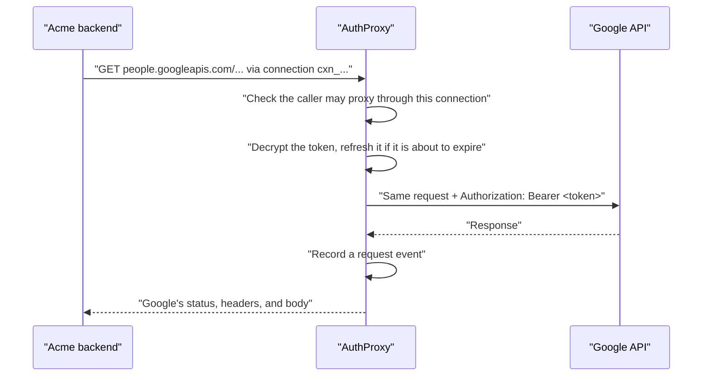

This page follows one integration from start to finish to introduce the ideas
the rest of the documentation relies on. The running example is a fictional
product, **Acme CRM**, whose customers want to sync contacts from their own
Google accounts.

## Three participants

Every integration involves three systems, and it helps to be clear about what
each one is responsible for.

**Your application** (Acme CRM) still owns everything about your product: who
your users are, which tenant they belong to, what features they can use, and
what to do with the data that comes back from Google. It also decides which
Google API calls to make and builds those requests itself.

**AuthProxy** owns the plumbing for third-party credentials. It runs the OAuth
sign-in, stores the resulting tokens encrypted, refreshes them, checks whether
they still work, and attaches them to outgoing requests. It also records a log
entry for each request.

**The third-party provider** (Google) owns the user's account, the consent
screen, the tokens it issues, and its API.

Your application never stores Google's tokens. It only stores an AuthProxy
connection ID, which on its own grants nothing.

## Connectors describe a provider

A **connector** is a YAML definition of how to connect to one provider. Acme's
Google Contacts connector would say "this uses OAuth 2.0, here are Google's
authorization and token endpoints, request the `contacts.readonly` scope, and
read the client ID and secret from these environment variables":

```yaml
apiVersion: authproxy.net/v1alpha1
kind: Connector
metadata:
  name: google-contacts
  namespace: root
spec:
  definition:
    displayName: Google Contacts
    description: Import your Google contacts into Acme CRM.
    auth:
      type: OAuth2
      clientId:
        envVar: GOOGLE_CLIENT_ID
      clientSecret:
        envVar: GOOGLE_CLIENT_SECRET
      authorization:
        endpoint: https://accounts.google.com/o/oauth2/v2/auth
      token:
        endpoint: https://oauth2.googleapis.com/token
      scopes:
        - id: https://www.googleapis.com/auth/contacts.readonly
          reason: Read your contacts so they can be imported.
  release:
    desiredState: primary
```

Connectors can also define setup questions to ask the user, health checks
(*probes*) that AuthProxy runs periodically, and how to handle provider rate
limits. You write a connector once and every customer uses it. See [Define a
connector](/integration/connectors/).

Connectors are versioned. Each published change creates a new immutable
**generation**, and existing connections keep using the generation they were
created with until you migrate them. This means editing a connector never
silently changes how existing credentials behave.

## Connections hold one account's credentials

A **connection** is one connected account: "Jane's Google account, connected
to Acme CRM on March 3rd." It stores the OAuth tokens or API key (encrypted),
any answers the user gave during setup, and two kinds of status:

- **Lifecycle state** says where the connection is in its life: being set up
  (`setup`), ready to use (`configured`), `disabled`, or being removed
  (`disconnecting`, then `disconnected`).
- **Health** says whether the credentials currently work (`healthy` or
  `unhealthy`), based on probes and on failures seen while proxying. A
  connection can be configured but unhealthy, for example after the user
  revokes access in their Google settings. The Marketplace then offers to
  reconnect it.

Each connection has an ID such as `cxn_QazSgUdZij5Jv6wX`. Your application
stores this ID next to its own record of the integration and passes it with
every request.

## Namespaces and actors decide who can use what

AuthProxy has to know who is calling it and what they are allowed to touch.
It uses two ideas for this.

A **namespace** is a folder-like path such as `root.tenants.acme_42`. Every
connector and connection lives in exactly one namespace, and permissions are
granted on namespaces. Acme might put each customer's connections in that
customer's namespace, so that one customer can never use another's
credentials. If Acme wanted each *user* to have private connections, it could
use `root.tenants.acme_42.users.jane` instead. AuthProxy does not assume
either model; you choose the namespace layout that matches how your product
shares integrations.

An **actor** is a user or service that calls AuthProxy. Acme's users become
actors, identified by Acme's own user ID (the actor's *external ID*). Each
actor has a list of permissions, such as "may create, list, and proxy through
connections in `root.tenants.acme_42` and anything under it."

Your application proves who the actor is by signing a short-lived JWT with a
key that AuthProxy trusts. AuthProxy does not have its own login screen for
your users. It trusts your application to have authenticated them. See
[Authenticate requests to AuthProxy](/integration/authentication/).

## Connecting an account

When Jane clicks **Connect Google** in Acme CRM:

1. Acme's backend signs a one-time token that identifies Jane and sends her
   browser to the AuthProxy Marketplace.
2. The Marketplace exchanges that token for a session and shows Jane the
   Google Contacts connector.
3. Jane clicks **Connect**. AuthProxy creates a connection in the `setup`
   state and redirects her to Google's consent screen.
4. Google redirects back to AuthProxy with an authorization code. AuthProxy
   exchanges it for tokens, encrypts them, and stores them on the connection.
5. If the connector defines follow-up questions or health checks, AuthProxy
   runs them. The connection becomes `configured`, and Jane is sent back to
   Acme CRM.

Acme's code never sees the authorization code or the tokens. For an API-key
connector, step 3 shows a form for the key instead of redirecting to Google.

You do not have to use the Marketplace UI. The same steps are available
through the API if you want to build your own interface.

## Making a request

Later, Acme's sync job wants Jane's contacts. It sends AuthProxy the request
it would have sent to Google, minus the credentials:



There are two ways to send a request. The *wrapped* endpoint takes a JSON
description of the request and returns a JSON envelope, which is convenient
in application code. The *raw* endpoint streams bodies through unchanged,
which suits file transfers and server-sent events. See [Proxying
requests](/sdks/proxying/).

## What happens in the background

Some work happens without your application asking for it:

- **Token refresh.** AuthProxy refreshes OAuth access tokens before they
  expire, both on demand during a request and in the background.
- **Probes.** If a connector defines probes, AuthProxy periodically calls the
  provider to check that the connection still works and updates its health.
- **Request events.** Every proxied request is recorded with its timing,
  status, actor, connection, and labels, so you can answer questions like
  "which customers are hitting Google rate limits?"

## Labels connect AuthProxy to your data

**Labels** are key–value tags, borrowed from Kubernetes, that you can attach
to namespaces, connectors, connections, and individual requests. Acme might
label each connection with `acme.com/workspace-id=ws_881`. Labels are copied
onto request events, so you can filter request logs and metrics by your own
identifiers. Labels are for lookup and reporting only. They never grant
access. See [Labels and annotations](/concepts/labels-and-annotations/).

## What AuthProxy does not do

- **It does not unify APIs.** You still write Google-specific and
  Salesforce-specific requests. If you want one "contacts" API across many
  CRMs, a unified API product is a better fit. AuthProxy is for teams that
  want each provider's full native API.
- **It is not a workflow engine.** It does not schedule syncs, map fields, or
  run business logic.
- **It is not your identity provider.** Your users sign in to your
  application. AuthProxy trusts the identity your backend asserts.

The [comparison with related projects](/reference/related-projects/) goes
into these trade-offs in more detail.

## The services you will run

AuthProxy is one binary that can run four services, together or separately:

| Service | Default port | Who calls it |
|---|---|---|
| `public` | 8080 | Browsers: the Marketplace, and OAuth providers redirecting back after consent. |
| `api` | 8081 | Your backend: managing connections and proxying requests. |
| `admin-api` | 8082 | Operators: the Admin UI and administrative automation. |
| `worker` | 8083 (health only) | Nobody. It runs background jobs such as token refresh and probes. |

They share a PostgreSQL (or SQLite) database and Redis. Only `public` needs
to be reachable from the internet. See [Deploy AuthProxy](/deployment/).

## Next steps

- [Follow the tutorial](/getting-started/first-connection/) to see these
  pieces working on your machine.
- Read [The core resource model](/concepts/core-model/) for the exact rules
  behind namespaces, actors, permissions, and names.
- Start [planning your integration](/integration/).
