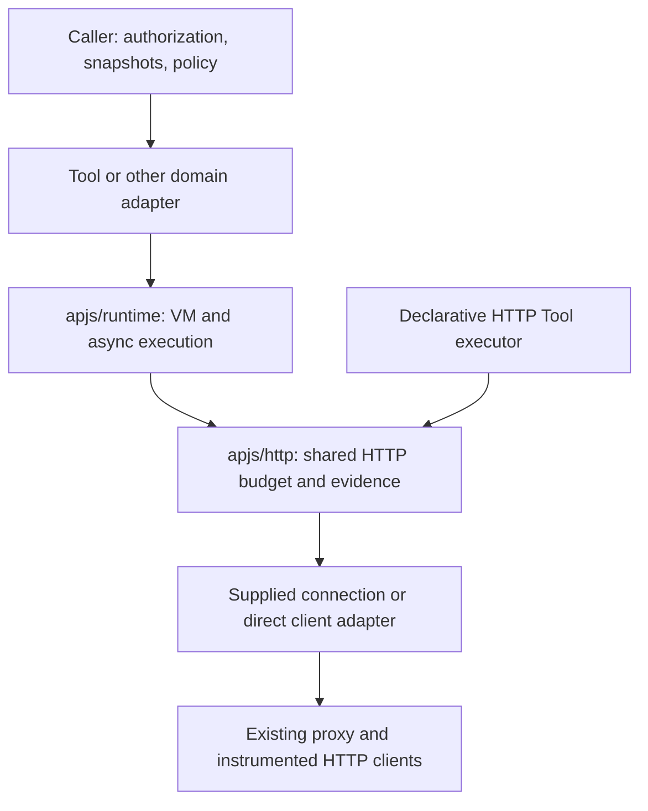

AuthProxy will centralize bounded JavaScript execution under `internal/apjs`.
Callers can evaluate a pure expression or run an async `execute` function with
zero or more explicitly supplied connections. Each connection exposes copied
configuration and metadata plus a method for authenticated HTTP requests.
Optional global `fetch` makes direct HTTP requests and is disabled by default.

This design records the November 6, 2026 architecture amendment to
[Tools and ToolSets](/development/design/tools-and-toolsets/). It defines package
responsibilities and execution contracts for contributors. The JavaScript
shapes and ownership rules below are the target contract; Go type and method
names can be refined during implementation without changing those rules.

The implementation starts with code already present in `internal/apjs`,
`internal/tools/javascript`, and `internal/tools/httphost` at main commit
`16de2e5d`. This document does not enable JavaScript Tool publication or change
database or REST contracts. Implementation tickets will be revised after this
design merges; the existing unification work is tracked in
[issue #1043](https://github.com/rmorlok/authproxy/issues/1043).

## Execute against supplied connections

A caller supplies a captured connection and input to this function:

```javascript
async function execute(params, context) {
    const [connection] = context.connections;
    const response = await connection.fetch(
        connection.cfg.apiBase + "/customers/" + encodeURIComponent(params.id)
    );
    if (!response.ok) {
        throw new Error("Customer lookup failed");
    }
    return response.json();
}
```

The caller must supply the expected connection before running this example.
`connection.fetch` uses that connection's configured HTTP client; credentials
stay in the proxy. `cfg.apiBase` comes from the caller's captured configuration,
including setup values such as a tenant or hostname. An ordinary thrown error
becomes a safe evaluation failure, without exposing its message or stack.

Other callers can supply several connections and let the script select one:

```javascript
async function execute(params, context) {
    const connection = context.connections.find(
        candidate => candidate.labels.region === params.region
    );
    if (!connection) {
        throw new Error("No supplied connection matches");
    }
    const response = await connection.fetch(connection.cfg.apiBase + "/health");
    return { connectionId: connection.id, available: response.ok };
}
```

There is no JavaScript connection lookup API. The caller selects, authorizes,
and prepares every connection before execution. Selecting from supplied entries
does not perform a second authorization decision or grant additional access.

## Package ownership

| Package | Owns |
| --- | --- |
| `internal/apjs` | Existing connector-library and expression APIs; compatibility adapters as their implementations adopt the shared primitives. |
| `internal/apjs/runtime` | Compilation, pure expressions, async programs, fresh VM lifecycle, bounded JSON input/output, cancellation, Promise tracking, the HTTP completion loop, JavaScript connection and response objects, and trusted extensions. |
| `internal/apjs/http` | Go-only HTTP execution sessions, shared budgets and send evidence, bounded response decoding, body ownership, and safe failure categories. Used by both JavaScript and declarative HTTP execution. |
| `internal/tools/javascript` | Tool context construction, single-connection policy, connector-helper selection, compatibility aliases, `toolResult`/`ToolError`, and Tool-specific result/error interpretation. |
| Existing `internal/tools/render`, `httpcodec`, `httpexec` | Typed Tool rendering, HTTP plans, schemas, and invocation outcomes, using the generic expression and HTTP primitives. |
| Existing core/proxy/HTTP integration | Connection authorization and hydration, configured clients, credential handling, attribution, telemetry, and adapters into the generic HTTP contract. |



The arrows show execution flow. Concrete client adapters are supplied by the
caller; the generic packages do not import core or proxy implementations.
JavaScript HTTP bindings stay with the runtime's completion loop so one owner
controls VM values, pending operations, and result conversion.

The new runtime and HTTP packages must not import root `apjs`, `core/iface`,
`httpf`, `schema/api`, `schema/common`, or `tools/*`. Root `apjs` is already a
dependency of schema and connection interfaces. Moving those imports unchanged
would prevent compatibility APIs from depending on the new runtime without
cycles. Use `encoding/json.RawMessage`, plain metadata, and narrow library and
transport interfaces. Adapters translate existing send evidence and trusted
credential-failure categories; they do not duplicate credential recovery or
transport instrumentation.

The runtime can accept a compiled-library interface with source inspection and
initialization in an owned VM. The existing `apjs.Library` can satisfy it without
the runtime importing its parent package. Only trusted Go integration code can
provide libraries, transports, or extensions.

## Caller and execution contracts

The Go caller supplies an immutable compiled program, effective positive limits,
a cancellation context, JSON input/context data, an optional ordered collection
of connection capabilities, and an optional direct HTTP capability. An earlier
absolute policy deadline can include preparation time. The generic API does not
load configuration or invent unlimited defaults; each caller resolves policy
before execution. Invalid options fail before authored code or outbound I/O.

Each execution creates a fresh VM. Compiled programs and libraries can be shared
concurrently; VM values, connection objects, pending operations, and result
state cannot. Inputs must remain stable while being copied. Returned data is
detached and owned by the caller, with no Goja objects or live response bodies.
The runner owns its execution session and request/response bodies, including
cleanup on failure. It does not close or reconfigure caller-owned HTTP clients
or their shared transports. No session or capability handle is reused in another
execution; reusable clients can be supplied again under a fresh session.

### Async programs and context

Require one top-level `async function execute(params, context)` declaration.
Compilation checks the entry point and reserved bindings without executing
authored code. Initialization checks the resulting callable, and invocation
requires a native Promise. Helpers and top-level constants are allowed.

`params` is the supplied JSON value, defaulting to `{}` when omitted. Domain
adapters can require an object and apply schemas; the generic runner does not
impose Tool schemas. `context` is a native object with these rules:

- `connections` is always an array, empty when no capabilities were supplied.
  It preserves caller order; duplicate connection IDs are rejected before I/O.
- The caller can supply additional JSON fields, such as Tool metadata. It
  cannot replace the reserved `connections` field with JSON input.
- The `connections` property, array membership, and each connection's top-level
  properties are read-only. JSON configuration, labels, annotations, and other
  caller data are private copies; nested edits affect only that VM.
- The generic runner does not select a default connection or install global
  `cfg`, `labels`, or `annotations`. A trusted domain adapter can install aliases
  that reference the same copied values, without duplicating their input charge.

Each connection object has the following surface:

| Member | Contract |
| --- | --- |
| `id`, `name`, `namespace` | Read-only identity strings captured by the caller; IDs are nonempty and unique within the execution. |
| `cfg` | JSON object of captured configuration, including setup/preconnect values. |
| `labels`, `annotations` | Copied string maps, empty when omitted. Labels are the caller's already-resolved snapshot. |
| `fetch(url, init)` | Read-only method bound to that connection's client and the execution's shared HTTP session. |

The host constructs native JavaScript objects and methods rather than exposing
a reflected Go connection, client, map, or response. A method captures a private
capability; it never resolves a client from an editable `id`, metadata, or `this`
value. Copying or borrowing a method keeps its original binding. A forged object
cannot acquire a client. Generic encoding explicitly rejects branded connection
capability objects, even when non-enumerable methods would otherwise be omitted.
Scripts return selected metadata explicitly.

Credentials, signing keys, credential-refresh controls, and live Go objects are
not supplied. Configuration can still contain sensitive administrator-provided
values: the caller chooses the exposed snapshot, and errors/default logs must
not disclose it. Editing `cfg` changes neither stored configuration nor the
configuration/attribution captured by the HTTP client.

Supplying multiple connections does not concatenate their connector libraries.
Libraries can declare conflicting names or assume a single `cfg`; the caller
explicitly selects the libraries and aliases appropriate to its execution.

### Pure expressions

A pure expression uses the same fresh VM, input/output conversion, and runtime
limits. It receives only copied JSON data and explicitly selected pure helpers.
It has no connection methods, direct fetch, async HTTP workers, or implicit Tool
result helpers. A Promise is not a JSON expression result. Domain adapters can
preserve existing expression bindings such as `response`, `cfg`, and `params`.

### Compilation and initialization

Count source bytes across the entry point and all supplied libraries. Disable
source-map loading during compilation and dynamic evaluation. Reserve built-in
host bindings, including disabled global `fetch`, and extension-declared names;
reject collisions in authored code and libraries before execution. Local
variables can shadow names without changing host globals.

Validation runs bounded initialization in a fresh VM without live connection
data or I/O. Pure extension helpers can be present. It does not call `execute`
or validate the eventual output. During real execution, inputs are copied and
hosts installed before initialization, but every outbound method remains gated
until initialization and its Promise microtasks have completed successfully.
No initialization path, including async work, can send a request.

### Reusable utility hosts

The planned `URL`, `URLSearchParams`, `TextEncoder`, `TextDecoder`, and text/base64
helpers (`atob`/`btoa`) belong to the shared runtime rather than the Tool adapter.
They perform no I/O and must bound host-side input/output allocations. They can
be implemented in separate slices; reserving a name does not make that utility
available. Their supported behavior must be documented when implemented.

A structured diagnostic logger is also a generic host supplied by trusted Go
code, using the existing logging/telemetry configuration. Bound authored log
records and preserve fixed execution attribution. Do not automatically log
arguments, configuration, credentials, HTTP bodies, or result payloads. Pure
expression profiles receive only selected pure helpers, not the logger.

## HTTP capability contract

### Connection requests and direct fetch

`connection.fetch(url, init)` preserves the configured connection client's
authentication, recovery, destination/Host support, rate limits, request events,
redaction, and telemetry. Its Go adapter fixes connection and actor attribution.
The generic host does not perform ACL checks or call a public proxy route.

Global `fetch(url, init)` is a separate direct HTTP capability. It is absent by
default and exists only when a trusted caller explicitly supplies a direct
client adapter. It does not add connection credentials or connection-auth
recovery. Authored headers remain request data. There is no default-client or
direct-network fallback when a connection request fails. Direct traffic uses
the existing instrumented HTTP factory through its adapter, with explicit
caller attribution and send-evidence collection.

Both paths use the same worker loop, request conversion, response objects,
deadline, and aggregate allowances. Tools never enable global `fetch`.

### Fetch subset

The initial request contract is a primitive absolute HTTP(S) URL and an optional
object with `method`, `headers`, and `body`. Default method is GET. Headers are
string-valued own properties; the existing Host override behavior is retained.
Body is a string or native ArrayBuffer. JSON requests use `JSON.stringify`
explicitly. Unsupported options are rejected, not silently ignored. Preserve
the existing Fetch method normalization and CONNECT/TRACE/TRACK exclusions.

The response exposes `status`, `ok`, `headers.get(name)`, `bodyUsed`, and async
`text()`, `json()`, and `arrayBuffer()` methods. HTTP error statuses resolve as
responses; transport and body-read failures reject with safe errors. Status and
header access do not read the body. Body consumption is single-use, beginning
only when a read worker is admitted; a refused worker admission leaves the body
available for a later read. Unused and failed bodies are closed.

Headers omit authentication, cookie, and hop-by-hop fields. No raw
`http.Response.Request` enters JavaScript. JSON parsing uses a captured parser
and bounded validation; malformed JSON diagnostics are not exposed. Text uses
the existing replacement behavior for invalid UTF-8; ArrayBuffer preserves
bytes. Preserve lazy identity/gzip decoding and bodyless-response handling.
This is an AuthProxy Fetch subset, not browser or Node.js compatibility.

### Request labels

Add `init.labels` to connection fetch as an explicit AuthProxy extension in a
separate implementation slice. It is a copied string map charged to the request
byte allowance. Invalid/protected labels fail before dispatch; request labels
can override connection user labels but cannot override system `apxy/` labels
or host-owned attribution. The resolved request labels feed existing rate
limits, events, redaction, and telemetry projection. They do not mutate the
connection's labels or the JavaScript metadata snapshot.

Configured connection clients currently capture labels at construction. This
requires an explicit per-request label operation or a captured client factory
that preserves connection/actor snapshots while varying request labels. Do not
mutate shared clients or insert context values that existing middleware ignores.
Until this slice is implemented, reject `labels` as unsupported. Direct fetch
keeps caller-configured attribution and does not accept this connection-specific
extension. Once supported, labels are optional per-call data on connection
fetch, with no additional runtime enable flag; omission adds no request labels.

## Budgets and execution evidence

One execution owns one deadline, one HTTP budget, and one aggregate evidence
tracker. Connection handles and direct fetch are dispatch choices under that
owner, not independent sessions with fresh allowances. The Go-only HTTP package
also supports a single-client declarative HTTP executor under the same rules.

| Limit | Accounting scope |
| --- | --- |
| Source bytes | Entry point/expression plus supplied libraries, before compilation. |
| Timeout and optional earlier policy deadline | Initial input copy, initialization, execution, waiting for I/O, and result conversion. Never restarted per connection or request. |
| Stack depth | JavaScript call depth in the owned VM. |
| Input bytes/nodes/depth | Combined initial params, extra context, and all connection snapshots. Host functions are not serialized input; aliases do not duplicate snapshots. |
| Output bytes/nodes/depth | One final JSON value or the whole payload selected by a trusted result extension. No per-field reset. |
| Logical request count | Shared across every connection and direct dispatch. Admitted calls remain charged even when later proven unsent. Credential retries/redirects remain governed by the supplied client's policy. |
| Request bytes | Per request: URL, method, headers, body, and supported request labels before worker dispatch. |
| Pending operations | Shared count of fetch and body-read work, including completions not yet consumed by the VM. Reserve before launching workers. |
| Decoded response bytes | Aggregate accepted decoded bytes across all body reads, including partial/discarded reads. Exhaustion cancels the execution's remaining I/O and interrupts JavaScript. |
| Stream bytes | Per response before host decompression; not a wire-byte limit because the supplied client may already decompress. |
| Response header bytes | Per copied header map, including entry overhead. |

Input and output have separate traversal counters. Each response JSON parse has
its own depth/node allowance under the aggregate decoded-byte budget. These
counters bound host conversion work, not JavaScript instructions. Invalid
requests rejected before logical dispatch consume no request count; admitted
requests are never refunded. Per-request rejections can be caught by the
script; execution-wide timeout or aggregate response exhaustion cannot be
caught to obtain a fresh budget. Creating another handle never adds allowance.

Evidence describes outbound sends, not business-action completion. Client
adapters report known-unsent, possibly-sent, or confirmed-sent outcomes across
all target attempts, including redirects and credential recovery. Credential
endpoint traffic is separate from target evidence. Missing reports and pending
dispatches remain uncertain; a later local rejection cannot erase an earlier
possible or confirmed send. Preserve per-call evidence and aggregate it across
all clients. No dispatches means known-unsent.

While work is outstanding, aggregate evidence is provisional. After every
dispatch settles, an all-known-unsent run can be classified as unsent. If a
caller already returned an uncertain outcome, late evidence cannot revise that
reported outcome. The Tool adapter maps evidence into its execution-state
contract and independently decides whether the Tool completed successfully.
No generic runtime path retries an entire script or rolls back earlier effects.

## Runtime ownership and shutdown

All Goja access and Promise callbacks run on one owner goroutine. Workers get
only detached Go requests/data and HTTP capabilities; they do not capture the
VM, authored values, or VM callbacks. Completions transfer ownership to the
owner or dispose of their response/body data when the owner has ended.

When the root Promise settles, observe the drained microtasks and rejection
state, stop admitting work, and cancel remaining requests/reads. A successful
`Promise.race` or handled failure does not fail solely because sibling work was
abandoned. An observed unhandled rejection still fails the execution. A pending
root with no host work capable of settling it fails promptly rather than
waiting out the timeout.

Cleanup closes unused bodies and cancels the HTTP session on every exit,
including invalid inputs after session ownership transfers. It does not wait
indefinitely for an uncooperative client or body `Close`. Such workers retain
only detached state and cannot call into a disposed VM. Worker panics and
`runtime.Goexit` produce completion failures and Go-side diagnostics without
private panic values or request/response payloads. The VM interrupt watcher is
joined before disposal. Only the thread-safe interrupt operation crosses the
VM's goroutine boundary.

Caller cancellation/deadline errors take precedence over policy expiration;
policy expiration remains a distinct safe limit failure. Check again after
conversion and cleanup before returning a result. Failed execution returns no
partial output, but retains send evidence for the caller's outcome mapping.

This remains trusted-administrator code in an in-process Goja runtime. Limits
are not a hard heap quota, native Goja built-ins are not immediately preemptible,
and cancellation cannot force an uncooperative Go transport to stop. Untrusted
tenant code, process isolation, durable workflows, modules, filesystem access,
environment access, subprocesses, and database handles are outside this design.

## Results, errors, and trusted extensions

The default result is detached JSON: null, booleans, finite numbers, strings,
dense arrays, and ordinary objects. Numbers follow JavaScript semantics. Reject
undefined, functions, symbols, BigInts, non-finite numbers, cycles, sparse
arrays, accessors, proxies, and unsupported exotic objects. Bounded conversion
reads data properties without calling getters or `toJSON` and uses intrinsics
captured before authored code. Preserve the existing raw-JSON Unicode rules;
typed text conversion must reject unrepresentable lone surrogate units rather
than silently replace them. Incoming JSON rejects unpaired surrogate escapes.

Generic errors classify invalid source/input/output, evaluation failure,
execution limits, and safe HTTP failures. Thrown values, source fragments,
stacks, URLs, credentials, and private parser/transport diagnostics do not cross
the result boundary. Trusted adapters can classify credential unavailability
separately from other transport failures, independently of send evidence.

A domain adapter can supply a trusted extension with these responsibilities:

1. Declare reserved names and install pure helpers before authored initialization.
2. Recognize explicitly branded success values or root rejections on the VM's
   owner goroutine. Ordinary objects with similar property names stay ordinary.
3. Select and encode their payload using the runtime's bounded encoder under
   the same execution deadline, then validate/convert it into detached domain
   data. Multiple fields share one output allowance.

Only explicit recognized root failures can use domain error conversion.
Unrelated unhandled rejections and ordinary thrown values remain safe generic
failures. Extensions cannot erase execution-wide limits, cancellation, or
transport evidence. No API returns a raw `goja.Value` for conversion after the
runtime has ended. Go extension callbacks obey cancellation and ownership just
like the other trusted host code.

The Tool adapter owns `toolResult` branding, rich content validation, ordinary
string-to-text-block conversion, and `ToolError`. The generic runtime knows
neither `api.ToolResult` nor Tool identifiers, schemas, revisions, or verbs.
Output-schema validation and the final serialized Tool envelope have separate
caller-enforced limits; helper payload bounds do not account for platform
metadata, base64 framing added later, or derived text duplication.

## Tool profile and compatibility

The Tool adapter passes exactly one already-authorized captured connection and
never supplies direct HTTP. Tool-only JWT execution still requires its Tool
verb, not `connections:proxy`. It preserves copied Tool metadata and the sole
connection's `cfg`/`labels`/`annotations` aliases for connector helper reuse.
Pure HTTP transforms receive data only. The
[Tools design](/development/design/tools-and-toolsets/#javascript-host) owns the
domain result and permission contracts.

Root `apjs.Context` currently has no cancellation parameter, uses reflected Go
input/export, and has domain conversions such as null-to-empty-object and
stringifying option values. Preserve those public-internal APIs during
extraction. Migrating their callers to explicit budgets/context is a separate
slice that tests or deliberately migrates these behaviors; a package move must
not silently change existing connector predicates, transforms, or hooks.

## Migration sequence and acceptance

After this design merges, update the master and component tickets and create
the migration slices. Link the shared work to #1043 and the Tool project;
historical merged PRs remain recorded as implemented at their original scope.

1. Extract bounded data conversion and VM lifecycle; replace Tool-specific
   snapshot inputs with generic JSON inputs and caller adapters.
2. Extract async compilation/evaluation and trusted extensions, preserving
   rejection tracking and no-I/O initialization.
3. Extract the neutral HTTP host and adapters, then separate its shared budget
   from bound clients. Migrate declarative HTTP consumers without changing their
   behavior; split mechanical moves from multi-client logic as needed.
4. Expose supplied connection objects and shared-budget selection through the
   JavaScript HTTP loop. Replace the Tool's authenticated global fetch examples
   and bindings with its sole connection's method.
5. Add optional direct global fetch, disabled by default and for Tools.
6. Rework the rich-result work in PR #1095 onto the Tool adapter, then implement
   ToolError and invocation/publication integration against the shared runtime.
7. Add per-request labels and migrate legacy connector expression callers in
   separate slices, preserving attribution and existing conversion semantics.

Target roughly ten significantly changed files per implementation PR, excluding
Markdown and generated Swagger. Larger mechanical moves can be separate PRs;
they should not also introduce substantial execution changes. Design approval
does not by itself enable new publication or invocation routes.

Acceptance tests must cover:

- Pure expressions with data only and no HTTP capabilities; async execution
  with zero, one, and multiple supplied connections, deterministic caller
  ordering, and selection by metadata.
- Native copied inputs, concurrent runtime isolation, fixed capability identity
  despite metadata edits or method borrowing, and absence of credential handles.
- Aggregate input/request/response/worker limits across different connections
  and direct HTTP; no allowance reset through selection or aliases.
- Direct fetch absent by default and always absent for Tools; no direct fallback
  after a proxied failure; direct traffic still records evidence/instrumentation.
- Existing request/response ownership, Host override, authentication recovery,
  known-unsent failures, partial effects, and safe error behavior.
- Initialization microtasks without I/O, root settlement with abandoned work,
  unrelated unhandled rejections, cancellation during conversion, worker
  panic/Goexit, late responses, and blocking cleanup without late VM access.
- Generic JSON results independent of Tool types; branded domain results and
  errors use the same conversion budgets and cannot forge trusted identities.
- Request-label precedence/protection and isolated concurrent requests when
  that capability is implemented; labels cannot change actor/connection identity.
- Declarative HTTP and pure-transform compatibility, and explicit legacy
  predicate/transform/hook compatibility as those callers migrate.

Use fake clients/providers, race tests, and the existing in-memory telemetry
tools. Keep the dependency graph acyclic and check it when moving packages.
Preserve package-level tests alongside each extraction rather than postponing
coverage to a final integration PR.
