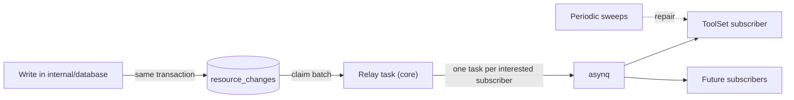

AuthProxy has resources whose state depends on other resources. A ToolSet's
bindings depend on connection labels and states. A connection's materialized
labels depend on its namespace and connector. Today each dependency is a
direct call: the resource that changed builds and queues the dependent's task.
This design replaces those calls with published **resource changes** that
dependents subscribe to. It then records those changes in a **transactional
outbox**, so that a committed change can't lose its follow-up work.

## Problem

### Producers know their consumers

[PR #1092](https://github.com/rmorlok/authproxy/pull/1092) makes ToolSets
follow connection changes. To do that, three connection code paths call a
ToolSet function:

- `CreateConnection` after the connection row is written
- `connection.SetState` after any state change
- `UpdateConnection` after a label change

Each new resource that cares about connections would add another call at
each of these sites. Deletion cleanup for ToolSets, which is still open under
#953, would add more. Connection code would then change whenever any other
resource's needs change.

The same pattern already exists for label propagation:
`enqueueNamespaceLabelPropagation` and `enqueueConnectorLabelPropagation`
queue `database/tasks` work from core whenever a parent's labels change.

Test setup pays for it too. In #1092, 4 of 12 files only teach strict asynq
mocks to accept the new task type, because every test that creates or changes
a connection now queues ToolSet work.

### Follow-up work can be lost

Every one of these calls queues work only after the change has committed, and
logs a failure without returning it. A Redis outage, a crash between the
commit and the queue write, or a bug that skips the call leaves the dependent
resource stale until a periodic sweep notices it:

- ToolSets rely on an hourly sweep (`core:sweep_toolsets`) to repair missed
  connection events.
- Label propagation relies on the daily carry-forward consistency check.

Some changes can't raise an event at all. When a namespace or connector
relabel is copied to its connections, the copying runs in
`internal/database` (`recomputeConnectionLabelsTx`). The database layer can't
import core, so it has no way to tell ToolSets that a connection's effective
labels changed. Those changes wait for the hourly sweep.

## Goals

- A resource that changes says only **what** changed. It doesn't know who
  depends on it.
- A dependent declares its interest in one place, with its own retries and
  its own repair sweep.
- A change that commits is always delivered to its subscribers at least once,
  including changes made inside the database layer.
- Delivery latency stays close to today's direct queueing.
- Works the same on SQLite and PostgreSQL.

Non-goals:

- Ordered delivery or delivery of the changed values. Subscribers read current
  state.
- A public or external event stream. This is internal plumbing; webhooks for
  host applications would be a separate design.
- Replacing asynq. Subscribers still run as asynq tasks.

## Design overview



The design has two parts that can ship separately:

1. **Registry** (phase 1). Core gets a `ResourceChange` type, a
   `ChangeSubscriber` interface, and a registry. Producers call
   `Publish`, which queues one task per interested subscriber after the
   commit, the same delivery as today. This removes the coupling but not the
   loss.
2. **Outbox** (phase 2). The database layer writes a row for each change in
   the same transaction as the change. A relay task reads those rows and
   dispatches them through the same registry. Subscribers don't change; only
   how changes reach them does.

## Change model

A change says that a resource changed and which aspects of it changed. It
deliberately doesn't carry the new values.

```go
// ResourceChange says that one resource changed. It identifies the resource
// and the aspects that changed; subscribers read current state themselves.
type ResourceChange struct {
    Kind      ResourceKind  // connection, toolset, namespace, connector, ...
    Id        apid.ID       // zero for kinds keyed by path, such as namespaces
    Namespace string        // the resource's namespace, or its path for a namespace
    Aspects   ChangeAspects // bitmask of what changed
}

type ChangeAspects uint32

const (
    AspectCreated ChangeAspects = 1 << iota
    AspectState                 // lifecycle state changed
    AspectLabels                // effective labels changed, including inherited ones
    AspectSpec                  // user-editable spec changed
    AspectDeleted               // soft-deleted
)
```

Carrying only identity and aspects has three consequences that the rest of
the design relies on:

- **Changes can be merged.** Several changes to one resource collapse into one
  by OR-ing their aspects. A namespace relabel that touches a connection three
  times dispatches once.
- **Order doesn't matter.** A subscriber always reads the latest state, so it
  doesn't matter which of two changes arrives first.
- **Duplicates are harmless.** Subscribers must already be idempotent, as the
  ToolSet passes are. At-least-once delivery is enough.

`AspectLabels` means the **effective** labels changed, so the label copying in
`internal/database` records it when inherited labels change. A user label
edit that leaves the effective labels unchanged records nothing.

## Subscribers and the registry

```go
// ChangeSubscriber is a resource or feature that keeps derived state in step
// with other resources. Implementations must be idempotent and must read
// current state when handling a change.
type ChangeSubscriber interface {
    // Name is stable and unique. It becomes the subscriber's asynq task type,
    // core:resource_change:<name>, so renaming it strands queued tasks.
    Name() string

    // Interested reports whether a change needs this subscriber's attention.
    // It is evaluated by the dispatcher and must not do I/O.
    Interested(c ResourceChange) bool

    // Handle does the follow-up work for one change. Returning an error lets
    // asynq retry; returning an error wrapping asynq.SkipRetry drops it.
    Handle(ctx context.Context, c ResourceChange) error
}

// ChangeSweeper is optionally implemented by subscribers that can repair
// everything they derive. The registry schedules it as a periodic task.
type ChangeSweeper interface {
    SweepCronspec() string
    Sweep(ctx context.Context) error
}
```

The registry lives in `internal/core`:

```go
type changeRegistry struct {
    subscribers []ChangeSubscriber
}

func (r *changeRegistry) Register(s ChangeSubscriber)

// Publish is the phase 1 delivery: queue one task per interested subscriber.
// It is called after the change commits and logs failures, as the direct calls
// do today. In phase 2 it is removed from producers; see Outbox.
func (s *service) publishChange(ctx context.Context, c ResourceChange)
```

- **Registration is explicit.** All subscribers are registered in one
  function next to `RegisterTasks`, never through `init()`, so a reader can
  find every dependency on a resource kind in one place.
- **Task wiring is generated.** The registry adds each subscriber's handler to
  the asynq mux in `RegisterTasks`, and each sweeper's periodic task to
  `GetCronTasks`.
- **One task per subscriber.** A slow or failing subscriber retries on its own
  and can't hold up another subscriber's work.
- **Payload.** The task payload is the JSON form of `ResourceChange`.

The first subscriber is ToolSets. It is interested in connection changes with
`AspectCreated`, `AspectState`, `AspectLabels` or `AspectDeleted`, its handler
is the existing per-connection pass (`reconcileConnectionToolSets`), and its
sweeper is the existing `core:sweep_toolsets`. The three call sites in #1092
become `publishChange` calls that name only the connection.

Test setup gets simpler. Tests stop mocking each subscriber's task type and
instead replace the registry with a recorder, then assert which changes were
published.

## Outbox

Phase 2 moves the record of a change into the database transaction that makes
the change.

### Table

Both migrations are added together, following the
`000026_create_task_checkpoints` pair.

```sql
-- SQLite; PostgreSQL uses bigserial for id and timestamptz for timestamps.
create table resource_changes (
  id            integer primary key autoincrement,
  resource_kind text not null,
  resource_id   text not null default '',
  namespace     text not null,
  aspects       integer not null,
  created_at    timestamp not null,
  claimed_until timestamp,
  claim_token   text,
  published_at  timestamp
);

create index idx_resource_changes_pending
  on resource_changes (published_at, claimed_until, id);
create index idx_resource_changes_published_at
  on resource_changes (published_at);
```

- `id` gives a rough order for claiming but is never used as a high-water
  mark. On PostgreSQL a lower id can commit after a higher one, so the relay
  selects by `published_at is null` and never by "ids after N".
- `claimed_until` and `claim_token` are a lease, so several worker replicas
  can relay without double-claiming and a crashed relay's rows become
  claimable again.
- Published rows are kept briefly for debugging and then purged.

### Recording a change

The database layer gets one internal helper and no public write API:

```go
// recordResourceChange appends a change to the outbox inside tx. Callers use
// it in every write that changes an aspect some subscriber watches.
func (s *service) recordResourceChange(ctx context.Context, tx *sql.Tx, c ResourceChangeRecord) error
```

The first set of writes to record, all for connections:

| Write | Aspects | Change needed |
|---|---|---|
| `CreateConnection` | created, labels | add the record to the existing insert |
| `SetConnectionState` | state | wrap the single `UPDATE` in a transaction |
| `UpdateConnectionLabels`, `PutConnectionLabels`, `DeleteConnectionLabels` | labels | record only when effective labels differ |
| `UpdateConnectionForGenerationMigration` | labels | migration hooks and the new connector generation can change labels |
| `recomputeConnectionLabelsTx` | labels | record only when the row was corrected |
| `DeleteConnection` | deleted | add the record to the existing soft-delete update |

Writes for other kinds are added when a subscriber needs them. A write that
forgets to record is the main new way to miss a change, so:

- Recording goes into shared write helpers where one exists, such as
  `writeRecomputedLabels`, so that new callers record automatically.
- A database test per watched kind exercises each write method and asserts the
  change it recorded, on both providers.
- The subscriber's sweep stays as the backstop for anything still missed.

### Relay

The relay is an asynq task in core, `core:relay_resource_changes`. It runs
every 5 seconds from the scheduler and also whenever a "drain now" request
arrives (see Latency). Each run repeats until the outbox is empty or its time
budget ends:

1. **Claim** a batch under a lease, using a fresh claim token:

   ```sql
   update resource_changes
      set claimed_until = :now + :lease, claim_token = :token
    where id in (
      select id from resource_changes
       where published_at is null
         and (claimed_until is null or claimed_until < :now)
       order by id
       limit :batch
       -- PostgreSQL only: for update skip locked
    )
   returning id, resource_kind, resource_id, namespace, aspects;
   ```

   SQLite has a single writer, so the update alone is safe there. On
   PostgreSQL, `for update skip locked` lets replicas claim disjoint batches.
2. **Merge** rows for the same resource within the batch by OR-ing their
   aspects.
3. **Dispatch** each merged change to every interested subscriber. Each task
   gets the ID `rc:<highest row id>:<subscriber>` and short asynq
   retention, so a retry of the same batch is rejected as a duplicate
   (`asynq.ErrTaskIDConflict`, treated as success) and not queued again.
4. **Mark** the batch published, but only rows that still carry this run's
   claim token. If any dispatch failed, the batch isn't marked. Its lease
   expires, the batch is claimed again, and subscribers that already received
   it are deduplicated by task ID.

The database interface gains the relay's operations:

```go
ClaimResourceChanges(ctx context.Context, limit int, lease time.Duration) (ResourceChangeClaim, error)
MarkResourceChangesPublished(ctx context.Context, claim ResourceChangeClaim) error
PurgePublishedResourceChanges(ctx context.Context, before time.Time) (int64, error)
CountPendingResourceChanges(ctx context.Context) (count int64, oldest time.Time, err error)
```

A daily task purges rows published more than 24 hours ago.

### Latency

Polling every 5 seconds alone would delay every change by up to 5 seconds. To
keep today's latency, the API path that made the change also queues a
best-effort drain request after the commit, using `asynq.Unique` with a short
TTL so a burst of changes produces one drain. Losing a drain request is
harmless, since the scheduled run picks the rows up.

### Phase 2 cutover

When the outbox ships, producers stop calling `publishChange`, because the
database now records each change. `publishChange` remains only for changes
that are not database writes, if any appear. Subscribers and their tests don't
change.

With the outbox in place:

- Inherited label changes reach ToolSets directly through
  `recomputeConnectionLabelsTx`.
- The ToolSet sweep only guards against bugs, so its cadence can drop from
  hourly to daily.

## Failure behavior

| Failure | Result |
|---|---|
| Redis unavailable when a change commits | The row waits in the outbox; the relay dispatches it once Redis is back. |
| Worker crashes after dispatch, before marking | The lease expires, the batch is claimed again, and task IDs deduplicate subscribers that already got it. |
| Two relays run at once | PostgreSQL: disjoint batches. SQLite: writes serialize; a reclaimed batch only causes deduplicated dispatches. |
| A subscriber keeps failing | Only that subscriber's task retries and is eventually archived; its sweep repairs it later. Other subscribers are unaffected. |
| A write path doesn't record its change | The subscriber's sweep repairs it on its next run. The per-kind recording tests are meant to catch this before it ships. |
| Outbox backlog grows | The pending-count metric and oldest-pending age show it; see Observability. |

## Observability

- **Metrics:** a gauge for pending outbox rows and the age of the oldest
  pending row, from `CountPendingResourceChanges`, plus counters for
  dispatched and deduplicated tasks per subscriber. Subscriber names are the
  only metric dimension, which keeps cardinality bounded.
- **Logs:** each relay run logs how many rows it claimed, merged and
  dispatched.
- **Tracing:** each subscriber task links to the relay run that dispatched it,
  through the existing asynq middleware.

## Alternatives considered

- **Keep direct calls.** Simple, but each new dependency edits every producer,
  and lost work still waits for a sweep.
- **In-process event bus.** Removes the coupling but loses events on a crash,
  and the database layer still can't publish.
- **Redis streams or asynq alone.** Not part of the database transaction, so a
  commit can still happen without its event.
- **PostgreSQL `LISTEN/NOTIFY` or logical replication.** PostgreSQL only, and
  `NOTIFY` isn't durable. SQLite must keep working.
- **Carry new values in the change.** Would allow subscribers to skip a read,
  but would forbid merging and make ordering matter. Reading current state is
  cheap here.

## Implementation plan

Each phase is one or two pull requests of about ten significant files.

1. **Registry.** Add `ResourceChange`, `ChangeSubscriber`, `ChangeSweeper`
   and the registry. Move the ToolSet connection triggers from #1092 and
   the ToolSet sweep onto it. Replace the per-task-type mock allowances in
   tests with a change recorder.
2. **Outbox storage.** Add the `resource_changes` migrations for both
   databases, `recordResourceChange`, the claim, mark, purge and count
   operations, and their tests on both providers.
3. **Recording connection changes.** Record changes in the connection writes
   listed above, including wrapping `SetConnectionState` in a transaction and
   recording from `recomputeConnectionLabelsTx`. Add the per-kind recording
   test.
4. **Relay and cutover.** Add the relay task, drain request, purge task and
   metrics. Remove `publishChange` from connection producers. Reduce the
   ToolSet sweep cadence to daily.
5. **Later adopters** (each optional, each its own pull request):
   - ToolSet and connection deletion cleanup from #953 as a subscriber to
     `AspectDeleted`.
   - Namespace and connector label propagation as subscribers to namespace
     and connector `AspectLabels`, replacing the direct enqueues in core.

## Open questions

- **Retention of task IDs.** Deduplication needs completed tasks retained in
  Redis for at least the lease length. The proposal is 10 minutes; confirm
  that's acceptable for Redis memory at expected change rates.
- **Large fan-outs.** Relabeling a large namespace records one row per
  connection whose effective labels changed. That's the real work, but if it
  proves heavy, the relay could dispatch merged namespace-level changes
  instead.
- **ToolSet self-triggers.** ToolSet create, selector and publish changes
  queue their own reconcile today. They could move to the outbox for
  durability, as a subscriber to their own kind, but that isn't needed to
  remove cross-resource coupling.
