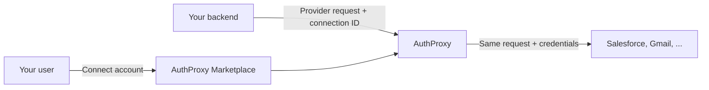

import { CardGrid, LinkCard } from '@astrojs/starlight/components';

## The problem it solves

Suppose you build a CRM and your customers want to connect their Salesforce,
Gmail, and Slack accounts. For each provider you need an OAuth client, a
callback endpoint, encrypted token storage, refresh logic, a way to show a
connection as broken when a token is revoked, and a settings page where users
can connect and disconnect. That code is nearly the same for every provider,
and it handles your customers' most sensitive credentials.

AuthProxy is that code, packaged as a service:

1. **You describe each provider once** in a YAML *connector*: its auth type,
   OAuth endpoints and scopes, and any setup questions.
2. **Your users connect their accounts** through AuthProxy's embeddable
   Marketplace UI. AuthProxy runs the OAuth or API-key flow and stores the
   result, encrypted, as a *connection*.
3. **Your backend calls the provider through AuthProxy.** It sends the request
   it wants to make along with a connection ID. AuthProxy adds the
   credentials, refreshes expired tokens, forwards the request, logs it, and
   returns the provider's response.

Your code still calls each provider's own API with its own URLs and payloads.
AuthProxy does not translate them into a common schema, and it does not run
workflows. Its job ends at authenticating and forwarding the request.

## Where to start

<CardGrid>
  <LinkCard
    title="How AuthProxy works"
    href="/concepts/"
    description="A ten-minute explanation of connectors, connections, and how a request flows through AuthProxy."
  />
  <LinkCard
    title="Try the hosted demo"
    href="/getting-started/demo/"
    description="Connect fake accounts in the Marketplace and look around the Admin UI and Grafana. Nothing to install."
  />
  <LinkCard
    title="Tutorial: your first connection"
    href="/getting-started/first-connection/"
    description="Run AuthProxy locally, define a connector, connect it, and watch AuthProxy add a credential to a request."
  />
  <LinkCard
    title="Compare with other approaches"
    href="/reference/related-projects/"
    description="How AuthProxy differs from unified APIs, embedded iPaaS products, and credential vaults."
  />
</CardGrid>

## Guides by role

<CardGrid>
  <LinkCard
    title="Add AuthProxy to your product"
    href="/integration/"
    description="Map your users and tenants, authenticate your backend, embed the Marketplace, and define connectors."
  />
  <LinkCard
    title="Deploy and operate"
    href="/deployment/"
    description="Install with Helm, choose the backing stores, and monitor requests and background work."
  />
  <LinkCard
    title="Review security"
    href="/security/"
    description="Trust boundaries, the permission model, credential encryption, and a review checklist."
  />
  <LinkCard
    title="Contribute"
    href="/development/"
    description="Run AuthProxy from source, learn the codebase, and run the tests."
  />
</CardGrid>
