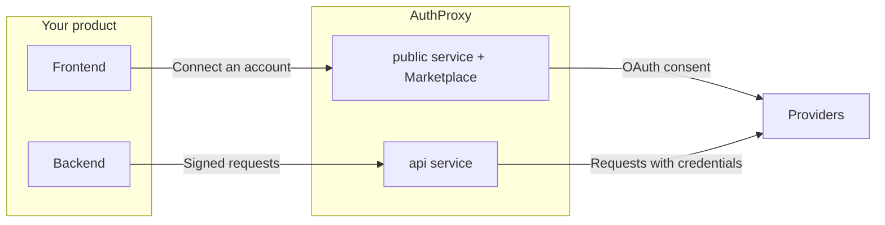

This section is for engineers adding AuthProxy to a product. It assumes you
have read [How AuthProxy works](/concepts/), and ideally run through the
[tutorial](/getting-started/first-connection/).

A typical integration touches three places in your system:

- **Your backend** signs tokens for AuthProxy, stores connection IDs, and
  sends provider requests through AuthProxy.
- **Your frontend** links to the AuthProxy Marketplace, where users connect
  and manage their accounts.
- **Your configuration** holds connector definitions, which you write once
  per provider.

## Decisions to make first

These choices are hard to change once you have real connections, so settle
them before writing code.

**How your users map to actors.** Each user or service that calls AuthProxy
becomes an actor, identified by an ID from your system. Use an immutable
primary key, not an email address.

**Who shares a connection.** If one Salesforce authorization serves a whole
customer account, connections belong in a tenant namespace such as
`root.tenants.acme_42`. If each user connects their own Google account, use a
per-user namespace such as `root.tenants.acme_42.users.usr_7`. Many products
use both, depending on the provider.

**Who creates actors.** Your backend can create actors ahead of time through
the API, or include the actor's definition in each token so AuthProxy creates
it on first use. The first is easier to audit. The second avoids a sync job.

**How you find a connection later.** Store the connection ID in your own
database next to the record it belongs to, such as an "installed
integration" row. You can also tag connections with labels like
`acme.com/installation-id=ins_123` for searching and reconciliation.

[Map users and tenants](/integration/host-application/) covers these
decisions in detail, with examples.

## Steps

1. **Deploy AuthProxy** or run it locally. See [Deploy
   AuthProxy](/deployment/) or the [quick start](/development/quick-start/).
2. **Set up token signing.** Generate a key pair, give AuthProxy the public
   key, and add a function to your backend that signs tokens for a user. See
   [Authenticate requests to AuthProxy](/integration/authentication/).
3. **Write connectors** for the providers you support, and register
   AuthProxy's OAuth callback URL with each provider. See [Define a
   connector](/integration/connectors/).
4. **Add a Connect button.** Add an endpoint to your backend that signs a
   one-time token and redirects to the Marketplace, and link to it from your
   settings page. See [Embed the Marketplace](/integration/marketplace/).
5. **Store connection IDs.** Look up the connections your users created and
   record their IDs in your database. See [Finding connections your users
   created](/integration/marketplace/#finding-connections-your-users-created).
6. **Send requests through AuthProxy.** Replace direct provider calls with
   calls to AuthProxy's proxy endpoint. See [Proxying
   requests](/sdks/proxying/).
7. **Watch it in production.** Use request events, connection health, and
   telemetry to spot failing connections and rate limiting. See [Operate
   AuthProxy](/operations/).

## What goes in a connector, and what stays in your code

Put behavior that is the same for every customer of a provider in the
connector: OAuth endpoints and scopes, where the API key goes, setup
questions, health checks, and how to handle the provider's rate limit
responses.

Keep product decisions in your code: who may install an integration, whether
it is shared across a team, which features use it, and what requests to make
and how to interpret the responses.
