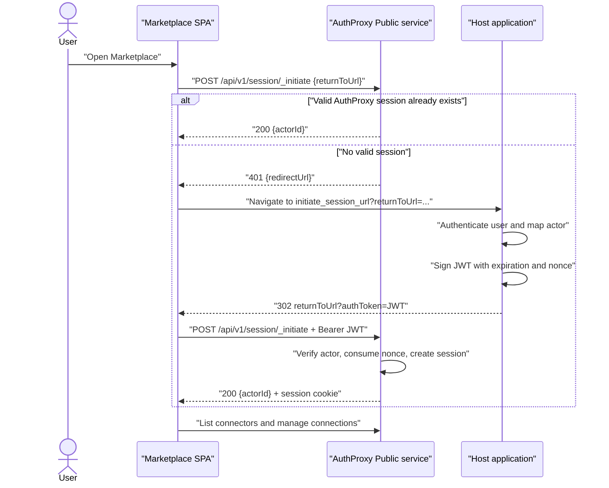

The Marketplace is a ready-made web UI where your users browse the connectors
you offer, connect their accounts, answer any setup questions, reconnect
accounts whose credentials stopped working, and disconnect accounts they no
longer want to use. You link to it from your product, for example from an
**Integrations** settings page.


Users do not log in to the Marketplace separately. Your backend, which already
knows who the user is, signs a short-lived, one-time JWT and redirects the
browser to the Marketplace. The Marketplace exchanges that token for its own
session cookie.

If you would rather build your own UI, everything the Marketplace does is
available through the API. The [tutorial](/getting-started/first-connection/#4-create-a-connection)
shows the calls for an API-key connector.

## Where the Marketplace is served from

| Mode | Configuration | Use when |
|---|---|---|
| Same origin | Set `public.static: {}` to serve the compiled Marketplace from the Public service. | You want the simplest cookie and CORS behavior. |
| Separate SPA origin | Set `marketplace.baseUrl` to the Marketplace origin and point its `VITE_PUBLIC_BASE_URL` at the Public service. | You deploy or brand the frontend independently. |

For a separate origin, AuthProxy derives a credentialed CORS policy from
`marketplace.baseUrl`. Deploy both origins over HTTPS and configure cookie
attributes for the browser context. Same-origin hosting is the safer default
when a separate frontend deployment is not required.

## Color mode

The Marketplace supports light and dark palettes. Choose a palette for either
deployment mode under `marketplace.colorMode`:

```yaml
marketplace:
  baseUrl: https://integrations.example.com
  colorMode: system
```

Set `colorMode` to `light` to keep the Marketplace light, `dark` to keep it
dark, or `system` to follow the browser's `prefers-color-scheme` setting. The
default is `system`; the Marketplace updates immediately if the operating
system preference changes while it is open.

The Public service exposes this non-secret setting to the SPA at
`GET /api/v1/marketplace/config`, so the same compiled frontend can be used for
all three modes. A separately hosted Marketplace must be able to reach that
Public service URL through `VITE_PUBLIC_BASE_URL`.

## SSO handoff



The configured `hostApplication.initiateSessionUrl` receives a `returnToUrl`
query parameter. After authenticating the user, the host redirects to that URL
with an `authToken` query parameter. The Marketplace moves the token into the
`Authorization: Bearer` header when it calls the session endpoint.

If authentication succeeds, the Public service consumes the nonce and creates
a server-side session. Later Marketplace calls use the session cookie and XSRF
protection instead of repeatedly exposing the JWT.

## Configure the handoff

For a separately hosted Marketplace:

```yaml
public:
  baseUrl: https://authproxy.example.com
  https: true
  cookie:
    sameSite: none

hostApplication:
  initiateSessionUrl: https://app.example.com/auth/authproxy

marketplace:
  baseUrl: https://integrations.example.com
```

The host endpoint follows this logic:

```text
require an authenticated host session
read returnToUrl
reject returnToUrl unless it matches an exact Marketplace allowlist
map the host user and tenant to an AuthProxy actor and namespace
sign an AuthProxy JWT for the Public service with a short expiration and nonce
redirect to returnToUrl with authToken=<jwt>
```

Sign the token with the key whose public half is configured as
`systemAuth.jwtSigningKey`. Set `aud` to `public`, set a short `exp`, and
include a fresh `nonce` that starts with `non_`. The actor must already exist
unless the token includes the full actor definition. [Authenticate requests to
AuthProxy](/integration/authentication/#sign-a-token) has a complete example
of a handoff token.

## Security requirements

- Authenticate the host session before signing anything.
- Allowlist complete Marketplace return destinations; do not implement an open
  redirect.
- Use a short expiration and a fresh nonce. AuthProxy accepts each nonce only
  once, but it only enforces this when the token contains a nonce.
- Scope the JWT audience and permissions to the Public Marketplace flow.
- Keep signing keys and provider credentials out of browser code.
- Use HTTPS. The handoff token briefly appears in a query parameter and must not
  be reusable.
- Keep `public.enableProxy` disabled unless browser-to-provider proxying is an
  explicit requirement; it is disabled by default.
- Do not use the demo identity picker as production authentication. It is only
  a stand-in host that demonstrates the JWT exchange.

## Finding connections your users created

When a user finishes connecting an account, they stay in the Marketplace.
AuthProxy does not currently call back into your application, so your backend
discovers new connections by listing them. Because each connection is created
in a namespace you chose, listing that namespace finds them:

```bash
curl "https://authproxy-api.internal.example.com/api/v1/connections?namespace=root.tenants.acme_42.**" \
  -H "Authorization: Bearer $TOKEN"
```

Filter further by connector or by label with a `labelSelector`, for example
`labelSelector=apxy/cxr/-/name=google-contacts`. Store the IDs you find on
your own records so later requests do not need to search.

## Local development

The CLI can stand in for the host application:

```bash
ap login-redirect --port 8889
ap sign-marketplace-login-url --actorId alice
```

`login-redirect` implements the `returnToUrl` handoff locally, while
`sign-marketplace-login-url` prints a Marketplace URL containing a one-time
token. See the [CLI reference](/development/cli/#ap-login-redirect).

After SSO is working, connector-authored forms, redirects, data sources, and
verification steps are controlled by the [Connector setup
flow](/integration/connector-setup-flow/).

## Next steps

- [Map users and tenants](/integration/host-application/)
- [Author connector setup](/integration/connector-setup-flow/)
- [Observe Marketplace requests](/operations/app-metrics/)
