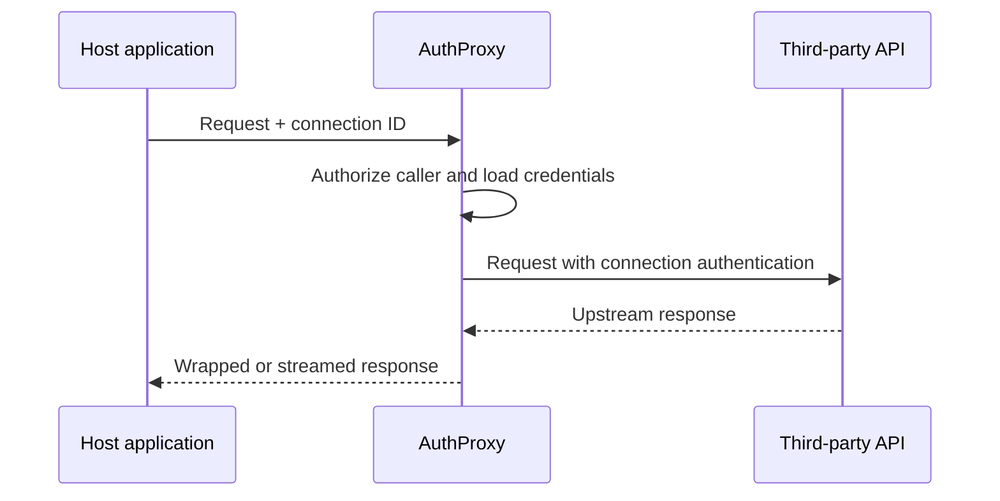

Once a user has connected an account, your application calls the provider by
sending the request to AuthProxy instead. AuthProxy's API is plain HTTP and
JSON, so any language works without an SDK. The repository also includes a
JavaScript/TypeScript client and the `ap` command-line tool.

## Choose an interface

| Need | Use |
|---|---|
| Manage AuthProxy resources from JavaScript or TypeScript | [`@authproxy/api`](/sdks/javascript/) |
| Send a normal JSON or other buffered request through a connection | The [wrapped proxy endpoint](/sdks/proxying/#wrapped-proxy) from any HTTP client, or the shared client exported by `@authproxy/api` |
| Stream uploads, downloads, or server-sent events | The [raw proxy endpoint](/sdks/proxying/#streaming-raw-proxy), normally through `ap proxy` |
| Explore or script an environment from a terminal | The [`ap` CLI](/development/cli/) |

The JavaScript SDK currently provides the broadest typed client surface in this repository. Other languages can call the same HTTP APIs directly.

## Authentication

Every call to AuthProxy carries an AuthProxy JWT, or a session cookie in the
browser. This proves who your application is acting for. It is not the
provider's credential, and AuthProxy never forwards it. See [Authenticate
requests to AuthProxy](/integration/authentication/) for how to create one.

When an application proxies through a connection, it sends the connection ID and the upstream request. AuthProxy authorizes the caller, loads the connection's encrypted credentials, applies them to the upstream request, and manages refresh or rotation behavior for the connector's authentication method.

For proxy requests, the caller needs the `connections:proxy` permission for the target connection. Scope application tokens to only the namespaces, resources, verbs, and resource IDs they require.

## Proxying model

The host application never needs the third-party OAuth token or API key. See [Proxying requests](/sdks/proxying/) for both request formats and runnable examples.
