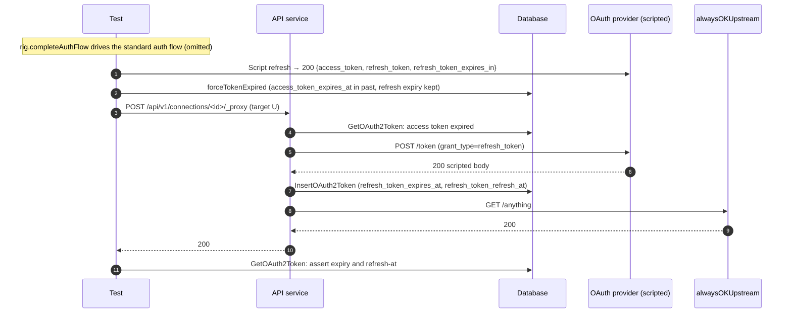

# OAuth2 Refresh-Token Expiry

Companion specification for `refresh_token_expiry_test.go`. Covers issue
#1002's refresh-token lifetime handling: reading the provider's
refresh-token expiry from token responses, persisting it, and scheduling a
proactive background refresh so idle connections don't lapse.

RFC 6749 §5.1 only defines `expires_in`, the **access** token's lifetime.
Providers that also report when the **refresh** token stops working use
non-standard fields, all in seconds from the response:

| Field | Provider / spec | Behavior modeled |
| --- | --- | --- |
| `refresh_token_expires_in` | [GitHub Apps user tokens](https://docs.github.com/en/apps/creating-github-apps/authenticating-with-a-github-app/refreshing-user-access-tokens) | Always `15897600` (6 months); rotates on every refresh. |
| `refresh_token_expires_in` | [LinkedIn programmatic refresh tokens](https://learn.microsoft.com/en-us/linkedin/shared/authentication/programmatic-refresh-tokens) | 1-year TTL fixed at the initial grant; later refreshes report the remaining time and do not extend it. |
| `refresh_token_expires_in` | [Google, time-based access](https://developers.google.com/identity/protocols/oauth2/web-server) | Present only when the user grants time-limited access. |
| `x_refresh_token_expires_in` | [Intuit QuickBooks Online](https://help.developer.intuit.com/s/article/Validity-of-Refresh-Token) | About 100 days, rotating. |
| `refresh_token_timeout` | [draft-ietf-oauth-refresh-token-expiration](https://datatracker.ietf.org/doc/draft-ietf-oauth-refresh-token-expiration/) | Max time the client may hold the token without exchanging it. The draft's `authorization_expires_in` (consent lifetime) is ignored for scheduling. |

AuthProxy takes the earliest deadline present, persists it as
`refresh_token_expires_at`, and sets `refresh_token_refresh_at` to
`token.refreshTimeBeforeRefreshTokenExpiry` (default 24h, capped at half the
remaining lifetime) before that deadline.

## Cases covered

| Test | Scripted token response | Asserted shape |
| --- | --- | --- |
| `TestRefreshTokenExpiry_ProviderResponseShapes` / `github refresh_token_expires_in` | Refresh: `refresh_token_expires_in: 15897600` | `refresh_token_expires_at` ≈ now + 6 months; `refresh_token_refresh_at` = expiry − 24h. |
| … / `google time-based access refresh_token_expires_in` | Refresh: `refresh_token_expires_in: 604800` | Expiry ≈ now + 7 days; refresh-at = expiry − 24h. |
| … / `intuit x_refresh_token_expires_in` | Refresh: `x_refresh_token_expires_in: 8726400` | Expiry ≈ now + 101 days; refresh-at = expiry − 24h. |
| … / `ietf draft refresh_token_timeout ignores authorization_expires_in` | Refresh: `refresh_token_timeout: 604800`, `authorization_expires_in: 2629800` | Expiry from `refresh_token_timeout` (7 days), not the consent lifetime. |
| … / `lifetime as numeric string` | Refresh: `refresh_token_expires_in: "1209600"` | Quoted numbers are accepted. |
| `TestRefreshTokenExpiry_InitialExchangeRecordsLifetime` | Code exchange (LinkedIn shape): `refresh_token_expires_in: 31536000` | Lifetime is captured on the initial grant, before any refresh. |
| `TestRefreshTokenExpiry_StandardResponseRecordsNothing` | None: the real go-oauth2-server RFC 6749 response | Both columns stay null; nothing is scheduled. |
| `TestRefreshTokenExpiry_FixedLifetimeStopsProactiveRefresh` | Two refreshes (LinkedIn shape): a 1-year lifetime, then the remaining seconds to the same deadline | Second row keeps the same expiry (±5s) and has **no** refresh-at. |
| `TestRefreshTokenExpiry_BackgroundScanSelectsDueRefreshTokens` | Refresh (GitHub shape): 30-day access token, 7-day refresh token | `EnumerateOAuth2TokensExpiringWithin(1h)` skips the connection now and one minute before refresh-at, and selects it one minute after. |

## What is asserted

- **Persisted columns.** The test reads the token row with
  `env.GetOAuth2Token` and checks `RefreshTokenExpiresAt` /
  `RefreshTokenRefreshAt` against the lifetime in the scripted response.
  Expiry tolerance is 30s, to cover proxy and request latency; refresh-at is
  checked to within 1s of expiry minus
  `connectors.DefaultRefreshTimeBeforeRefreshTokenExpiry`.
- **No failures.** Each response-shape case asserts no
  `oauth token refresh failed` event. A malformed lifetime field would make
  the response malformed and fail the refresh.
- **Fixed lifetimes stop rescheduling.** When a refresh doesn't push the
  deadline later, refresh-at is cleared. Otherwise the background task would
  re-select the connection every run until it expired.
- **Background selection.** The scan is evaluated at fake clock times
  through `apctx` with `k8s.io/utils/clock/testing`. The 30-day access token
  keeps the access-token criterion from matching, so only the refresh-token
  criterion can select the row.

## Why scripted responses and a local upstream

The docker test provider (go-oauth2-server) follows RFC 6749 and never
returns refresh-token lifetime fields, so each case scripts the token
endpoint with a provider-shaped body. Scripted access tokens aren't valid at
the provider's resource server, so proxying to `/echo` would get a 401,
trigger the retry-after-refresh path and burn extra scripted actions. The
refresh-path cases therefore proxy to `alwaysOKUpstream`, a local
`httptest` server that returns 200 to anything. The refresh is triggered by
`forceTokenExpired`, not by the upstream's answer.

`forceTokenExpired` (in `proxy_refresh_test.go`) only forges the
access-token expiry. It carries the refresh-token expiry columns forward
unchanged, which `FixedLifetimeStopsProactiveRefresh` depends on: the second
refresh compares against the first refresh's recorded expiry.

## Sequence

## What is *not* covered here

- **The background task actually refreshing.** The scan's selection is
  asserted directly. Running the asynq periodic task end to end isn't
  needed: once a token is selected, the task enqueues the same forced
  refresh covered elsewhere in the refresh suite.
- **Parsing edge cases** (null, empty string, garbage, non-positive
  values) and the lead-time cap. Unit tests cover these in
  `internal/auth_methods/oauth2/refresh_token_expiry_test.go`.
- **`refreshInBackground: false` and custom lead times.** Also covered by
  unit tests in that file.
- **Surfacing an "expires soon" health signal.** Not implemented. A
  non-extendable refresh token currently expires and the next refresh fails
  `invalid_grant`.

## Components

| Lever | What it controls |
| --- | --- |
| `newProxyRefreshRig` + `completeAuthFlow` | Shared refresh fixture from `proxy_refresh_test.go`: a Ready connection with real provider tokens. |
| `scriptedRefreshThroughProxy` | Scripts one 200 refresh response with the given body, forces the access token expired, proxies to the local upstream, and returns the new token row. |
| `alwaysOKUpstream` | Local always-200 upstream so scripted access tokens don't trigger 401 retries. |
| `provider.Script(…, EndpointToken, …)` | Scripts the authorization-code exchange response for the initial-grant case. |
| `env.Db.EnumerateOAuth2TokensExpiringWithin` + fake clock | Evaluates the background scan at chosen times. |
| `connectors.DefaultRefreshTimeBeforeRefreshTokenExpiry` | The 24h default lead time the refresh-at assertions use. |
